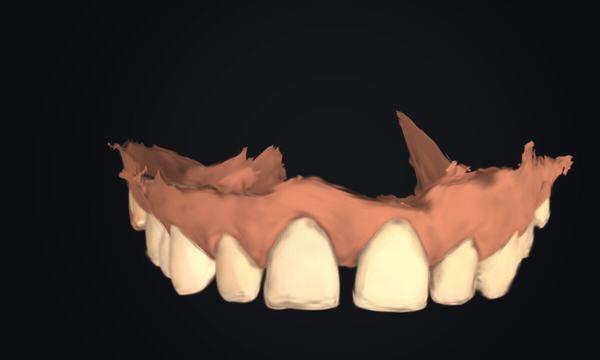
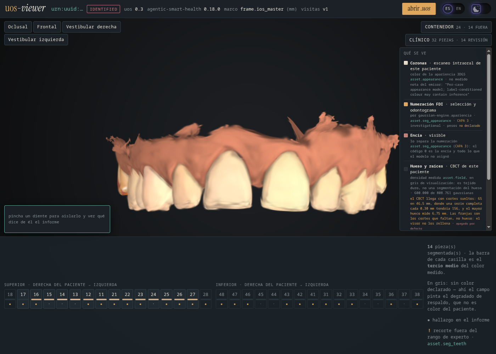
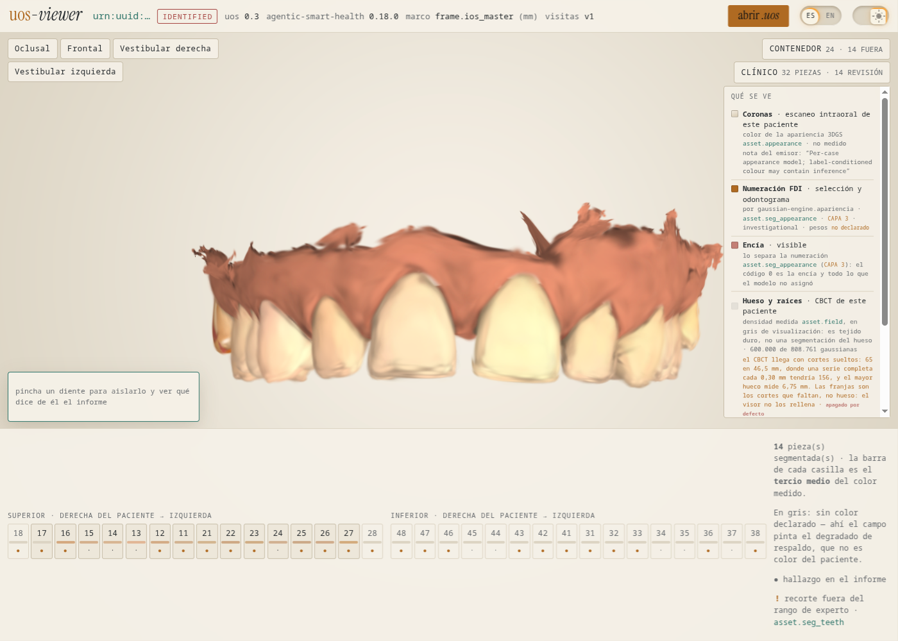
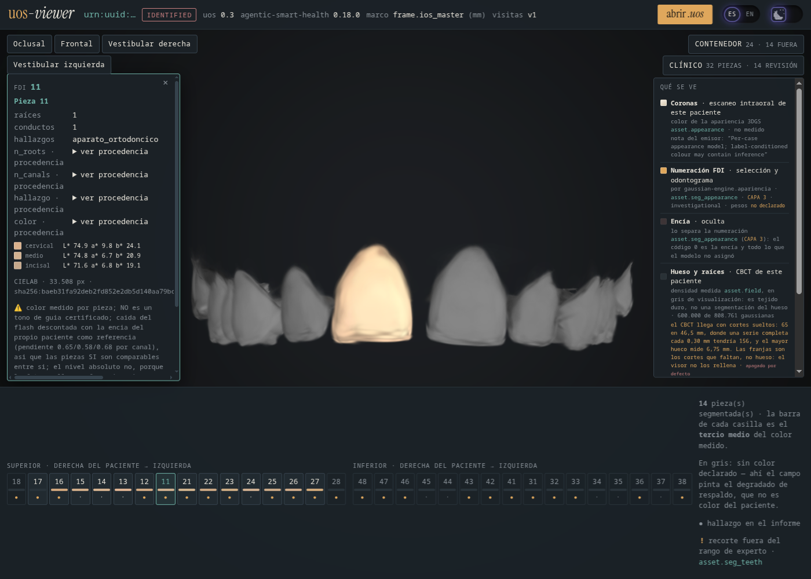
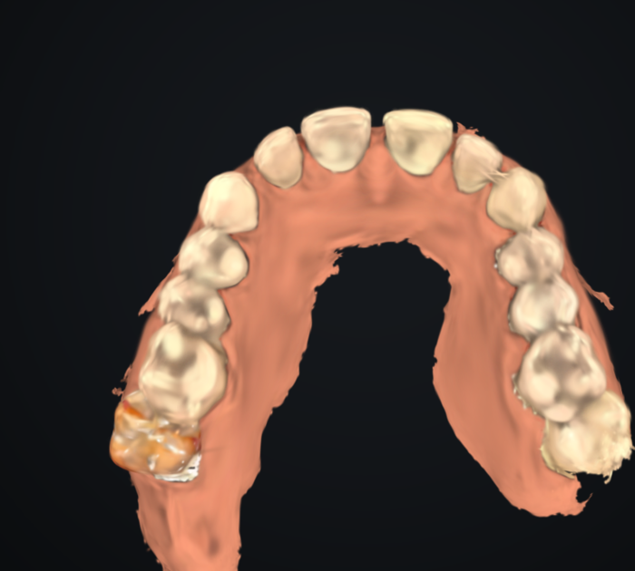
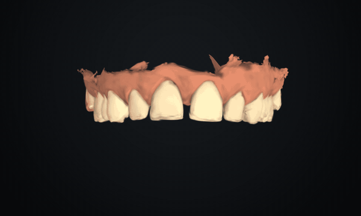

# uos-viewer

Visor de referencia del formato **Unified Oral Scene** (`.uos`), Layer 1: visualización y
medición manual, **sin inferencia**.

Abre un contenedor `.uos` **sin saber nada de quién lo escribió**: lee el manifiesto,
resuelve los assets por prioridad de carga, y baja de la red sólo lo que va a enseñar. Es
el punto de que UOS sea un formato y no *el formato de alguien*.

```bash
npm install
npm run dev          # arrastra un .uos a la ventana
npm test             # los tests del lector (ver más abajo)
```

## Cómo se ve: el caso de noviembre



Un paciente real, abierto tal cual sale del emisor (`agentic-smart-health` 0.18, segmentación
FDI C3). Todo lo dibujado es de este paciente:

- **Coronas**: la apariencia 3DGS del escáner intraoral, entrenada con la numeración C3. Su
  color **no es medido**: lo aprendió el ajuste y depende de la etiqueta de cada gaussiana
  (esmalte donde dice diente, encía donde no).
  - Antes el emisor reutilizaba la apariencia entrenada en agosto con la numeración del
    modelo de entonces, renumerada con C3: 25.148 de sus 113.540 gaussianas pasaron de
    diente a encía y conservaban el color del diente, así que la encía de la vista frontal
    salía con una franja de unos 2 mm del color del diente alrededor de cada corona.
  - El emisor ya no reutiliza una apariencia cuya frontera diente/encía cambió, y este caso
    se ha regenerado con la apariencia entrenada con C3: la encía llega rosada hasta las
    coronas. «Qué se ve» enseña la nota del emisor que avisa de que el color depende de la
    etiqueta.
- **Numeración FDI** (Capa 3, `investigational`): la pone `gaussian-engine.apariencia`, y
  es la que separa la encía. La encía sale oculta por defecto y se enciende desde «Qué se ve».
- **Hueso y raíces**: la densidad medida del CBCT, en gris de visualización. La registración
  CBCT → escáner declara rms 0,56 mm y está **sin verificar por una persona**. Este CBCT
  llega con **cortes sueltos**: 65 en 46,5 mm, donde una serie completa cada 0,3 mm tendría
  156, con huecos de hasta 6,75 mm. Encendida, la capa sale como una persiana de láminas,
  así que **arranca apagada** y el panel dice por qué.
- **Conductos nerviosos**: este contenedor no los trae, y el visor no los infiere.

| Modo oscuro | Modo claro |
|---|---|
|  |  |
| **Pieza 11 aislada** desde el odontograma, con su ficha | **Vista oclusal** |
|  |  |

Las capas, una a una: encía visible, encía oculta, el hueso encendido (con sus cortes sueltos)
y la pieza 11 aislada, con el resto en gris.



**Vídeo** (20 s, con rótulos): [`docs/medios/noviembre-recorrido.mp4`](docs/medios/noviembre-recorrido.mp4).

Se publica con el consentimiento de uso y publicación del paciente, confirmado por el
equipo clínico. El contenedor no se versiona (ver `.gitignore`), y las capturas tapan su
identificador `urn:uuid`. Los vídeos y GIF se generan fotograma a fotograma desde el lienzo
del visor, no grabando la pantalla: así el orden de los splats está asentado en cada fotograma.

## Español e inglés

La interfaz está en **español y en inglés**, con el selector ES | EN junto al interruptor de
tema. Sin elección guardada abre en español si el navegador está en español, y en inglés si
no. La elección se recuerda (`localStorage`, clave `uos-viewer:idioma`), y `index.html` la
aplica antes de la primera pintura.

- **Los textos van junto a la componente que los pinta** (`src/app/ui/idioma.tsx` explica
  el patrón): cada una declara su `es` y su `en`, y el compilador obliga a que tengan las
  mismas claves.
- **Se traduce la interfaz, no los datos.** Ids, métodos, hallazgos del informe y notas del
  emisor salen tal como los trae el contenedor.
- **Los reparos y errores del lector salen en español** en los dos idiomas: los escribe
  `src/uos`, que no se toca. Van marcados con `lang="es"`.

## La interfaz es React; el render no

React (19, en `src/app/ui/`) pinta **sólo** la interfaz: barra, esquinas, modales,
odontograma y ficha. El render sigue siendo three imperativo —`Escena`, `Splats`,
`Apariencia`, `Regenera`— detrás de una sola costura, `src/app/Visor.ts`, que React crea en
un efecto y libera en su limpieza. No hay react-three-fiber, y `src/uos/` no sabe que React
existe.

- **El lienzo lo crea el `Visor`, no JSX.** Cada montaje trae un `<canvas>` nuevo: un lienzo
  cuyo contexto se perdió devuelve ese mismo contexto perdido a `getContext`.
- **`Visor.dispose` lo suelta todo**: bucle, `DropInViewer` y sus workers de ordenación,
  geometría, destino del picking, controles, `resize` y el contexto (`forceContextLoss`).
  Cerrar el modal del contenedor termina el worker de regeneración si sigue calculando.
- **`StrictMode` se queda puesto** porque su doble montaje es la prueba. En desarrollo,
  `__uosDiagnostico()` en la consola cuenta contextos WebGL y workers vivos. Medido con un
  caso real: al arrancar, 2 contextos creados, 1 perdido, **1 vivo**; un segundo `Visor`
  con el contenedor cargado sube a 2 contextos y 2 workers, y tras su `dispose` vuelve a
  **1 y 1**. El contador no entra en el build de producción.

## Qué lo separa de un visor cualquiera

**No recibe una lista de ficheros: recibe un contenedor y lo interroga.**

Un `.uos` es un ZIP **sin comprimir** con el directorio central al final, y eso no es un
detalle de empaquetado: es lo que permite leer el índice —unos pocos KB— y bajar **un asset
suelto** sin traerse el caso entero. Sobre un caso real con CBCT, leer un corte de la serie
son unos KB frente a los 299 MB del contenedor.

`ZipReader` implementa esa lectura por rangos contra tres orígenes —HTTP, un `File` que el
usuario arrastra, o el disco en Node— detrás de una interfaz de dos métodos. Y falla
ruidosamente donde el spec lo exige:

- **`manifest.json` tiene que ser la primera entrada física.** Es la identificación
  positiva del formato; la extensión del fichero no prueba nada.
- **Sólo STORE.** Un `.uos` con entradas deflate rompe el acceso aleatorio, que es el
  motivo de que el formato sea un ZIP y no un tar.
- **El servidor tiene que honrar `Range`.** Si responde `200` en vez de `206` está mandando
  el fichero entero: se falla, porque el caller creería bajar 4 KB de índice y estaría
  bajando cientos de megas, y sólo se notaría en la factura.
- **ZIP64 se detecta y se declara.** Todavía no se soporta, y leer un contenedor de más de
  4 GB con los campos de 32 bits daría offsets truncados: entradas apuntando a mitad de
  otro fichero, sin error.

## Estado frente al §11 del spec

Lo implementado es el **§11.1 (pipeline de carga)** y los pasos **1 y 3 del §11.2**. Lo
demás está por hacer y aquí queda escrito cuál es cuál, para que nadie lo dé por hecho.

| §11 | Estado |
|---|---|
| `UosLoader`: manifiesto, `load_priority`, carga perezosa | **sí** |
| `ZipRangeReader` (HTTP / `File` / disco) | **sí** |
| Verificación `sha256` por asset, a petición | **sí** |
| Sacar un asset al disco, verificando el hash antes (§8: export ⇒ obligatoria) | **sí** |
| Grafo de marcos: los que no conectan con el canónico se declaran | **sí** |
| Colocar una capa en el canónico con las registraciones declaradas | **sí**, el campo CBCT (`Marcos.ts`) |
| Vistas guardadas (§7): aplicar una a la cámara | **sí** |
| Assets-directorio (serie DICOM): un corte suelto por rango | **sí** |
| Sidecar del volumen (§5.2), sin parser DICOM en el cliente | **se lee** |
| **1. Mesh pass** — geometría opaca, material clínico neutro | **no**, y a propósito (ver abajo) |
| **2. Volume pass** — raycast contra `Texture3D`, presets CBCT, depth-aware | no |
| **3. GS pass** — splats por capa, encendibles | **sí** · densidad aditiva + apariencia rasterizada (ver abajo) |
| **4. Overlays** — MPR, clip planes, mediciones, anotaciones | no |
| Picking semántico → código FDI, con resaltado de la pieza | **sí**, por gaussiana (`region_id`) |
| MPR sincronizado · timeline dual · deep-links | no |
| `SignalLoader` · `DerivedLoader` | no |
| `raw.zst` del volumen (`fzstd`) | no |

### No hay paso de malla, y es una decisión del formato

El §11.2 empieza por geometría opaca y este visor lo hacía: `scene.glb` primero, gaussianas
encima. Se quitó porque **el contenedor de este proyecto lleva sólo el campo gaussiano y el
manifiesto** — el escaneo original y la malla convertida viajan fuera, declarados por su
`sha256`. Dibujar una malla que el `.uos` no lleva era enseñar algo distinto del modelo.

Con ella se fue el picking por raycast, que estaba definido sobre los vértices de un
`scene.glb`. En su sitio hay un **pase de selección sobre las propias gaussianas**: se
redibuja el píxel bajo el cursor con el código FDI como color y con profundidad encendida,
así que gana la gaussiana más cercana a la cámara. El código sale de la columna `region_id`
de la capa de apariencia, y el sidecar declara lo que es — `measured: false`, vocabulario
ISO-3950, «vecino más cercano» — para que unas etiquetas de inferencia no se lean como
medidas. Ver `Splats.piezaEn`.

**La consecuencia, dicha:** un `.uos` antiguo que traiga `scene.glb` se abre igual, pero se
ve lo que traiga en gaussianas y no su malla.

### Dos rasterizadores, porque son dos físicas

El §11.2 pide un solo GS pass. Aquí hay dos caminos, y la razón es el dato:

- **Campo de densidad** (`ash-twin/1.0`) → sprites aditivos propios, en `Splats.ts`.
  Composición por suma, sin ordenar. El porqué está abajo.
- **Apariencia** (`ash-gs-apariencia/1.0`) → **`@mkkellogg/gaussian-splats-3d`**, que es lo
  que el spec nombra en §11.2 paso 3, en `Apariencia.ts`.

**Por qué la apariencia necesita el rasterizador de verdad, medido.** Es 3DGS: mezcla
alfa, que **no** es conmutativa. Y el entrenamiento reparte la imagen entre unas pocas
gaussianas opacas y decenas de miles de «neblina» — mediana de alfa **5/255**, con sólo el
17,9 % por encima de 32/255. Dibujando sprites sin ordenar, esa neblina multiplica por
`(1−α)` lo que tiene delante *y* lo que tiene detrás: la superficie se borra a sí misma y
queda polvo. Además un splat es una **elipse** —la proyección de la covarianza 3D— y el
sprite era un círculo de radio `scale_0`, con una anisotropía mediana de 2,5× y de 48,6× en
el percentil 95.

Se monta como `DropInViewer`, un `THREE.Group` colgado de nuestra escena, para que la
cámara siga siendo de `Escena`: las vistas guardadas del §7 traen su `up` medido.

El rasterizador admite como mucho 32 escenas, y cada pieza es una. Si una dentición no
cabe, las piezas más pequeñas **se funden con la encía**: se dibujan, pero no se pueden
aislar, y un aviso las nombra.

**Al pulsar una pieza, el resto pasa a gris** y ella conserva su color: en modo oscuro un
gris algo más apagado que la pieza, y en claro un gris claro, casi blanco, porque sobre el
beige un gris oscuro pesaba más que la pieza pulsada. Antes el resto sólo
bajaba de opacidad, y no se distinguía: una corona son miles de gaussianas superpuestas, y
aunque cada una deje pasar más luz, juntas siguen tapando casi lo mismo. El rasterizador
sólo expone visibilidad y opacidad por escena, así que el gris se injerta en su shader de
vértices como un uniform más por escena (`Gris.ts`). Si una versión nueva de la biblioteca
cambia ese shader, el injerto no encaja, el visor vuelve a apagar con la opacidad y lo
avisa en la consola. Un test comprueba las anclas contra la biblioteca instalada. Sigue sin
dibujarse un borde: el contorno de un diente cae en el margen gingival, que es justo lo que
interesa mirar.

**Y `Splats` conserva la geometría de la apariencia, invisible**, para dos cosas que el
rasterizador no da: la caja de encuadre y el pase de selección contra `region_id`. El
rasterizador reordena las gaussianas por dentro, así que un índice suyo no es el nuestro.

### El paso de densidad es ADITIVO, y no es un atajo

El 3DGS de facto pinta apariencia —color con armónicos esféricos, opacidad aprendida— y su
mezcla alfa **exige ordenar cada gaussiana por profundidad en cada fotograma**. Lo que este
contenedor trae es otra cosa, y lo declara en su sidecar `.gs.json`: `density` es **sigma**,
atenuación medida por el CBCT, y no hay color en ninguna parte.

Un campo de densidad se compone **sumando**, que es lo que hace un rayo al atravesarlo
(Beer-Lambert). Y sumar es conmutativo: no hay que ordenar nada. Por eso este paso cabe en
un fichero (`src/app/Splats.ts`) en vez de en una biblioteca — no es una simplificación que
se pague en calidad, es que la física del dato es más simple que la de una foto.

Dos consecuencias que van escritas en el panel al lado de cada interruptor:

- **el color de cada capa es falso color**, para distinguir dos capas encendidas a la vez.
  No significa tejido ni densidad, y no se puede medir encima;
- **la opacidad es sigma reescalada por una ganancia de visualización**, porque una sigma
  normalizada cae casi entera bajo el suelo de 1/255 del rasterizador y sin ella la capa se
  ve negra. La ganancia es de display y no viaja al artefacto.

Un `.ply` cuyo sidecar declare otro perfil **no se pinta**: sus columnas se llaman igual y
no significan lo mismo, así que dibujarlo daría una imagen plausible y falsa. Se salta
diciéndolo.

**Y la limitación grande, medida: el campo llega DIEZMADO y por eso se ve como puntos.**
El `cbct-agent` siembra σ = medio vóxel en cada eje —(0,075, 0,075, 0,225) mm sobre un vóxel
de 0,15 × 0,15 × 0,45—, que es correcto. Pero el volumen trae ~12 M de vóxeles de tejido
duro contra un tope de 1,5 M, así que submuestrea con `occupied[::9]` **sobre un array en
orden raster**: se come ocho de cada nueve a lo largo de un solo eje. Medida la separación
entre gaussianas consecutivas dentro de una fila, **1,35 mm en el 73 % de los casos**, con
σ = 0,075 en ese eje — o sea **σ/separación = 0,056**. Sondeado dentro del hueso más denso,
el campo va de 1,21 en el centro de una gaussiana a 0,016 entre ellas: **rizado del 99 %**.

No es una nube: son planos densos separados 1,35 mm. Y **no es el precio de que el dato sea
medido** — es que el submuestreo es anisótropo por construcción y σ no se reescala con él.
Se arregla diezmando en el espacio en vez de en el raster y escalando σ con el factor.

Lo que hace este visor mientras tanto es dibujar cada sprite inflado hasta el espaciado
medido de la nube —calculado con una rejilla espacial, validado contra un KD-tree con 0,0 %
de error—. Es un apaño, y encima corto: ese espaciado (0,212 mm) es la distancia al vecino
de OTRA fila, no el hueco real de 1,35 mm.

Los campos de los casos de prueba de hoy son rejillas de CBCT, y con ellas el apaño ya no se
queda corto: el espaciado se mide **eje a eje** y el splat cubre el **más separado**. Los dos
casos tienen 0,3 × 0,3 mm en el corte, pero 0,45 o 0,6 mm entre cortes. Con el vecino más
próximo (0,3 mm) quedaba una franja vacía entre corte y corte, y el hueso se veía rayado en
horizontal. El lado del splat es 2 × ese espaciado, porque su perfil es gaussiano: con el
lado igual al espaciado, a medio camino entre cortes el perfil ya ha caído al 13 %. Lo que
crece el splat se devuelve en alfa, con un exponente **medido** (1,4) y no el 2 del área. El
lienzo es de 8 bits, y por debajo de 1/255 la aportación se redondea a cero: con el 2, el
hueso de agosto recibía el 4 % de la luz que recibía antes. Con 1,4 recibe la misma en
agosto y el 117 % en noviembre. El hueso sale algo más suave en el corte, que es justo el
aspecto de cristal que se buscaba.

**La limitación que el spec ya reconoce y aquí también:** componer GS translúcido con
volumen translúcido no tiene solución exacta con dos pasadas independientes. Cuando llegue
el paso 2, la política de v1 será GS encima con opacidad global, y en vistas con volumen
activo el GS en modo *shell* con opacidad ≤ 0,5. Documentado, no escondido.

## Apariencia del render

Cambia el aspecto, no el método: siguen siendo los splats 3DGS de la apariencia y el campo
gaussiano del CBCT. No hay mallas sólidas.

- **Fondo**: casi negro en modo oscuro y beige en claro, con un degradado radial suave
  (`Escena.ponFondo`). Es la «luz suave», y no ilumina nada: los splats no se sombrean, y
  el relieve sigue siendo el n·v del armónico de grado 1 que escribe el emisor. Por eso lo
  único que se puede suavizar sin tocar el color del paciente es el fondo.
- **Coronas**, por orden de preferencia, para cualquier contenedor:
  1. **Con apariencia 3DGS** (`KHR_gaussian_splatting` en `scene.glb` o
     `derived/appearance.glb`): su **color real** (`f_dc`, albedo). El tema no lo toca. El
     falso color por FDI (`Derivados.colorDe`) no se usa para pintar.
  2. **Sin apariencia pintada pero con compuesto CBCT + escáner** (`scene/composite.ply`, el
     mismo camino del §11.2 que el campo del CBCT): sus gaussianas con
     `source_modality = 1`, en `Escaner.ts`. Solo si el descriptor declara un perfil de
     medida (`ash-twin/1.0`, `histora-twin/1.0`) y `measured: true`. Un compuesto ajustado
     no se pinta como forma del escáner, y el panel dice por qué. Posición, escala y rotación son **forma
     medida** del escáner y se colocan con la registración declarada. El color es **marfil
     neutro de visualización** y la opacidad también es de visualización. `density` **no**
     se lee como opacidad: en el escáner vale 0, porque el escáner no mide atenuación. Se
     dibujan con el mismo rasterizador que la apariencia, porque son elipses opacas de
     superficie. Hay dos ajustes de display, y el panel los nombra:
     - Cada gaussiana se dibuja al menos al 90 % del espaciado **medido** de la nube. En
       agosto, σ = 0,066 mm frente a 0,133 mm entre vecinas: sin el ajuste, las caras
       frontales salían moteadas.
     - El relieve sale de las normales que declara la malla de `scene.glb`, y solo si sus
       vértices caen uno a uno sobre esas gaussianas (≤ 0,001 mm). La malla no se dibuja, y
       si no se puede leer se pierden el relieve y la numeración por malla, no las coronas.
  3. **Sin ninguna de las dos**: solo se ve el CBCT.

  En cada caso «Qué se ve» dice qué falta. La numeración FDI **no se puede apagar**: es el
  índice con el que se lee un caso dental, y apagarla sólo quitaba la selección y el
  odontograma. Su fila lleva su Capa, su régimen y el hash de sus pesos tal como los declara
  su sidecar. Sale solo si alguna gaussiana dibujada tiene pieza. Para las coronas del
  escáner sale, por orden:
  1. Del `derived_seg` del **compuesto**, si numera alguna gaussiana del escáner. Se
     cuenta por `source_modality`, no se supone.
  2. Si no, del `derived_seg` de la **malla del escáner**. Se une a las gaussianas solo con
     la correspondencia uno a uno medida (≤ 0,001 mm en el canónico). `leeEtiquetas`
     comprueba además el marco y los hashes, y el orden contra el `source_positions_sha256`
     cuando el sidecar lo declara.

  Una columna `region_id` que el compuesto traiga por su cuenta, sin un `derived_seg` que la
  declare, no se usa. La frontera por pieza y el margen gingival salen de la segmentación
  que numera y, si ella no los declara, de la que sí lo haga. La ficha y el odontograma
  nombran siempre de qué `derived_seg` salen.

  El visor no infiere ninguna etiqueta: une un código que el contenedor ya trae y dice de
  dónde sale. En el caso de agosto, el del compuesto numera 236.261 gaussianas del CBCT y
  ninguna del escáner, así que la numeración sale de `seg_teeth` y el panel lo dice.
- **Hueso y raíces**: el campo **medido** del CBCT (perfil de gemelo, sin la columna
  `source_modality` del compuesto), en gris translúcido. Es tejido duro por encima del
  umbral del emisor, **no una segmentación de hueso**, y el panel lo dice. Se coloca con
  las registraciones que **declara** el manifiesto, compuestas hasta el marco canónico. Si
  no hay camino, la capa no se dibuja, porque colocarla a ojo sería inventar un
  alineamiento. Sale encendido salvo que la cadena sea *provisional* (§6). Si está *sin
  verificar*, se enciende igualmente y se dice al lado.
  - **También sale apagado si al CBCT le faltan cortes** (`Espaciado.mideCortes`): algún
    hueco entre cortes vecinos de al menos el doble del paso regular de la serie. Cada
    corte se dibuja bien, pero entre ellos no hay nada que dibujar. Ensanchar los splats
    hasta tapar los huecos sería inventar hueso donde no hay medida, así que el visor no lo
    hace: dice cuántos cortes hay, cuántos tendría la serie completa y el mayor hueco.
  - En oscuro **emite**: se suma (`dst + src`).
  - En claro **absorbe**: se multiplica (`dst · (1 − src)`). Es Beer-Lambert en forma de
    producto, como una radiografía.
  - Las dos composiciones son conmutativas, así que la decisión de no ordenar se mantiene.
- **Encía**: apagada por defecto, para que las coronas se lean como dientes y no como una
  arcada. La separa la numeración en uso: el código 0 es la encía **y todo lo que el modelo
  no asignó**, y el panel lo dice. Las piezas que no caben en el rasterizador van con ella.
- **Raíces**: las gaussianas del CBCT del compuesto que su `derived_seg` asigna a una pieza
  (`source_modality = 0` y código ≠ 0), en marfil de visualización, dentro del hueso. Solo
  se dibujan si el contenedor las numera: en agosto son 236.261; noviembre no numera
  ninguna y la capa no aparece. Es el diente entero del CBCT, corona incluida: por encima
  de la encía lo tapa el escáner. En claro absorben en gris cálido y no en ámbar: el
  amarillo es del conducto, y ninguna otra capa puede llevarlo.
- **Conductos nerviosos**: amarillo reservado. **Ningún contenedor trae hoy esa capa**, y el
  visor (Layer 1) no la infiere. El panel lo dice en vez de callarlo. Dibujarla exige que
  el emisor la escriba primero.

El panel **«Qué se ve»** existe por una diferencia de procedencia que la imagen sola no
dice. Un render dental puede ser anatomía de referencia (un CBCT de otra persona ajustado a
una radiografía) y verse igual de convincente. Aquí las coronas son el escaneo intraoral de
este paciente, numeradas por un modelo (Capa 3), y el hueso y las raíces son su CBCT. El
panel se construye con lo que de verdad se dibuja.

## Lo que dice la segmentación, pieza a pieza

Los paneles son los de agosto. Sólo se ha añadido lo que permite leer los cambios del
segmentador desde entonces, y **todo sale del sidecar de cada `derived_seg`**: el visor no
sabe qué modelo se usó, sólo lo que el contenedor afirma.

- **Contenedor → Inferencia**: por cada segmentación se enseñan modelo, versión, pesos
  (`sha256` abreviado), régimen (Capa e `investigational`), qué asset indexa, piezas
  presentes, frontera por pieza y margen gingival. Lo que viene a `null` se enseña como
  «no declarado» y no se rellena: un modelo congelado sólo aparece aquí cuando el emisor
  escribe su versión y el hash de sus pesos.
- **Ficha de la pieza**: el aviso de `per_tooth_boundary` (la regla de
  `Derivados.avisoDeFrontera`, que ya tenía tests y había quedado sin usar desde que se
  quitó la malla). Debajo, el margen gingival de esa pieza en uno de tres estados:
  anclado al surco, sin surco claro o propuesto sin aplicar. Si falta `gingival_margin`,
  significa «no se ejecutó» y no «no movió nada».
- **Odontograma**: un `!` en las piezas cuyo recorte cae fuera del rango de experto.

Los motivos de la puerta de revisión ya estaban en «Clínico» y no cambian.

## Tests

Los tests corren contra `.uos` **de verdad**, porque lo único que no prueba un fixture
inventado es que un ZIP escrito por otra herramienta —con sus extras y sus cabeceras— se lea
bien. Los contenedores no se versionan (son datos clínicos), así que los tests **se saltan**
si no están en vez de fallar en el CI de quien clone el repositorio:

```bash
UOS_CORE=/ruta/a/core.uos UOS_VOL=/ruta/a/con-volumen.uos npm test
```

Dos de ellos cuentan los bytes pedidos y exigen que abrir el contenedor y leer un asset
cueste una fracción de su tamaño: es la prueba de que la lectura es de verdad por rangos y
no una descarga disfrazada.

## Y qué NO es

No es `dental-3dgs-viewer`, que enseña el gemelo de un pipeline concreto consumiendo su
sidecar. Éste abre el `.uos` de cualquier emisor y sólo se fía del manifiesto.

Tampoco hace inferencia. Layer 1: lo que se ve es lo que alguien midió, y lo que salga de un
modelo vive en `derived/`, que es desmontable por diseño.

## Licencia

MIT. El formato es un borrador abierto; una implementación de referencia que no se pueda
copiar no sirve de referencia.

## Compatibilidad del complete case de octubre de 2026

Lee los documentos clínicos `ash-clinical/1.0` e `histora-clinical/2.0`, incluyendo
valores con procedencia individual, alternativas y campos ausentes. Un documento
clínico no soportado se comunica sin interrumpir la visualización.

La apariencia puede estar en la escena original o en un GLB separado bajo
`derived/`. La regeneración conserva la identidad y el hash de ambas fuentes.
El panel Contenedor presenta el registro de fidelidad declarado por el emisor;
no valida evidencia ni acredita aptitud clínica. Se mantienen los perfiles de
agosto y se reconocen los perfiles `histora-*` explícitamente soportados.

Las etiquetas FDI pueden viajar como assets `derived_seg` separados, indexados
por gaussiana o por vértice. Se verifica su fuente, hash, recuento y, cuando existe,
el hash de posiciones antes de aplicarlas. La selección y el aislamiento muestran
la ficha clínica aunque las fronteras de la segmentación requieran revisión.
La exportación conserva las etiquetas inferidas y su procedencia.
